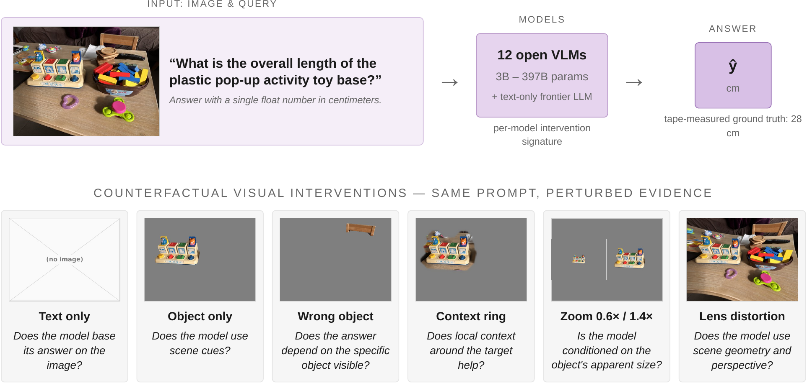

# Metric VQA — evaluation & intervention code

Code for **"Ill-Posed by Design: Probing Evidence Use in VLMs"**: a diagnostic
benchmark that asks what evidence a vision-language model actually uses when
estimating the physical size of an object from a single image.



- **Dataset:** [bmeivar/MetricVQA](https://huggingface.co/datasets/bmeivar/MetricVQA)
  (331 tape-measured in-the-wild queries with human-verified masks +
  10,482 Objectron-derived queries)
- **Paper:** [arXiv — Ill-Posed by Design: Probing Evidence Use in VLMs](https://arxiv.org/abs/XXXX.XXXXX)

## Install

```bash
pip install -r requirements.txt
export METRICVQA_ROOT=/path/to/working/dir   # where data and results live
```

Expected layout under `METRICVQA_ROOT`: the HuggingFace dataset contents
(`itw/`, `objectron/`) plus a `results/` directory that evaluation runs write
into and the analysis scripts read from.

## Quickstart

**1. Evaluate a VLM on the benchmark**

```bash
python vlm_eval.py \
  --model "Qwen/Qwen2.5-VL-7B-Instruct" \
  --csv $METRICVQA_ROOT/itw/questions.csv \
  --image-dir $METRICVQA_ROOT/itw/images \
  --output-dir $METRICVQA_ROOT/results/qwen2.5-vl-7b \
  --device 0 --dtype fp16
```

Handlers cover Qwen-VL, LLaVA, InternVL, Molmo, SmolVLM, Gemma 3, granite,
PaliGemma, Phi-3.5-V and a generic fallback (registry in `vlm_eval.py`; add a
family by subclassing `BaseVLMHandler`). `text_only_baseline.py` runs the
image-free language-prior probe.

**2. Generate the intervention canvases**

```bash
python interventions/run_sam3_masks.py          # SAM-3 masks from referring phrases
python interventions/build_context_variants.py  # object_only / object_ring / wrong_object / random_mask
python interventions/build_zoom_variants.py     # zoom-in 1.4x / zoom-out 0.6x
python interventions/build_distorted_variants.py # radial lens distortion (barrel / pincushion)
python interventions/build_target_plus_ref.py   # target + reference-object canvases
python interventions/extract_fractions_gt.py    # well-posed fraction-probe ground truth
```

The released dataset already contains verified masks, so step 1 of mask
extraction is only needed for new images.

**3. Reproduce the analysis**

```bash
python analyze_results.py                        # accuracy tables across results/*
python analysis/frontier_deltas.py               # paired intervention deltas (single source of truth for the frontier tables)
python analysis/fdr_analysis.py                  # scene-clustered sign-flip permutation tests + BH-FDR
python analysis/flip_rate.py                     # prior-vs-image churn analysis
python analysis/prediction_displacement.py       # paired log-ratio displacement per channel
python analysis/scene_zoom_analysis.py           # natural scene-crop zoom control
python analysis/build_tables.py                  # LaTeX tables
```

Figure scripts in `figures/` regenerate the paper's radar plots, the Acc@k
sweep, and the dataset composition figure.

## Evaluation conventions

- Primary metric **Acc@10%**: |pred − gt| / gt ≤ 0.1.
- Unparsable responses are **excluded** from accuracy denominators (a parse
  failure is an instruction-following failure, not a size estimate); parse
  rates are reported alongside. Paired deltas use rows parsable in both
  conditions.
- Significance for model counts: per-model paired sign-flip permutation tests
  with signs flipped at the **scene** level, Benjamini–Hochberg correction
  across the full model×channel grid.
- Deterministic decoding (`temperature=0`, `do_sample=False`); prompt suffix
  *"Answer with a single float number in centimeters."*

## Layout

```
vlm_eval.py               evaluation harness (handler registry)
handler_utils.py          shared handler utilities
text_only_baseline.py     language-prior probe (no image)
train.py                  LoRA fine-tuning reference (rank 8, alpha 32)
interventions/            canvas generation + intervention-specific eval
analysis/                 statistics behind every number in the paper
figures/                  paper figure generation
data_prep/                Objectron extraction + dataset packaging
```

## License

Code: MIT. Dataset: CC-BY-4.0 (in-the-wild) / Objectron terms (derived split)
— see the dataset card.
